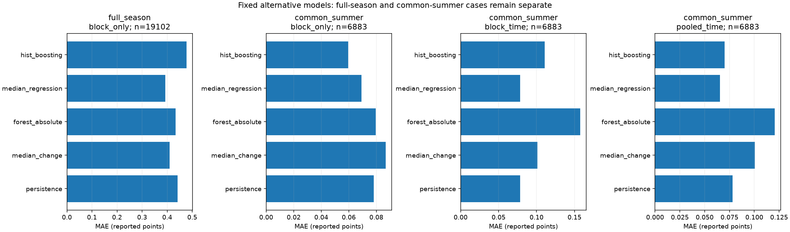

# Median regression and boosting for soil-water forecasts

We fitted both proposed alternatives on the existing transfer splits, with
fixed settings and unchanged observations. **The model form matters:** median
regression improves full-season spatial MAE over both constant references.
Boosting improves the matched summer spatial score. Both alternatives improve
the pooled time-only score. Forecasting a future month in a held-out block
remains difficult: median regression is essentially tied with persistence there.

The [plan](alternative-models-plan.md) fixes this comparison before fitting.
All four blocks and all months had already informed earlier exploration.
These results are exploratory, not a newly untouched test or a formal change
to the preregistration. We changed no observation, cleaning rule, target,
predictor, split, or earlier fitted model.

## Same summer rows: 6,883 scored location-hours

Every method below uses identical summer timestamps and outcomes in each
design. The scope contains four blocks, 74 distinct dates, and 296 location-days.
MAEs use reported water percentage points. Smaller values are better.

| Design | Persistence | Training median | Forest | Median regression | Boosting |
| --- | ---: | ---: | ---: | ---: | ---: |
| Block only | 0.07819 | 0.08681 | 0.07956 | 0.06932 | 0.05947 |
| Block plus time | 0.07819 | 0.10121 | 0.15742 | 0.07816 | 0.11076 |
| Pooled time control | 0.07819 | 0.10062 | 0.12046 | 0.06546 | 0.07018 |

For retrospective spatial transfer, boosting improves on persistence by
**23.9%**, and median regression by **11.3%**. Both beat the constant median
on these summer cases. The same models are evaluated on the full-season
scope below, where the ranking differs substantially.

For the pooled time-only control, median regression improves on persistence
by **16.3%**, and boosting by **10.3%**. These models can use earlier labels
from the target block. This result therefore supports a different claim from
forecasting a block excluded from fitting.

For block-plus-time transfer, median-regression MAE is 0.078164538, compared
with persistence at 0.078191196. That is a difference of approximately
0.0000267 points, or **0.034%**. It is a numerical advantage over both constants,
but not evidence of a practically meaningful or reliable improvement.
Boosting still loses to persistence in that design.



## Full observed season: spatial transfer

This scope contains **19,102 location-hours**, across 208 dates and 830
location-days. Each held block is excluded from fitting, while other blocks
contribute throughout January–August. These are retrospective spatial scores.
They cannot be substituted for future-forecast errors.

| Method | Pooled MAE | Equal block-month MAE | RMSE |
| --- | ---: | ---: | ---: |
| Persistence | 0.44168 | 0.42538 | 1.44751 |
| Training median | 0.40977 | 0.39456 | 1.44525 |
| Forest | 0.43406 | 0.42214 | 1.41083 |
| Median regression | 0.39180 | 0.37722 | 1.35452 |
| Boosting | 0.47682 | 0.46157 | 1.43410 |

Median regression reduces pooled MAE by **4.4%** relative to the training
median, and by **11.3%** relative to persistence. Its equal block-month mean
MAE also improves on both constants. Its full-season error is lower than
persistence at every block. It improves on the training median at three
blocks, with a very small disadvantage at B North.

| Held block | Persistence | Training median | Median regression | Boosting |
| --- | ---: | ---: | ---: | ---: |
| P | 0.48668 | 0.45384 | 0.41791 | 0.37527 |
| Cc | 0.52731 | 0.49381 | 0.46757 | 0.91065 |
| B North | 0.37020 | 0.33521 | 0.33540 | 0.30363 |
| F | 0.38352 | 0.35717 | 0.34721 | 0.32273 |

Boosting does worse than both constants over the full season, despite its
summer advantage. We retain that result rather than selecting only its
favorable evaluation scope. The forest still does not beat the constant
median overall. Median regression now provides an input-dependent improvement
over that stronger reference at the fixed settings tested.

## Month and block variation on common summer cases

| Design / month | Persistence | Median regression | Boosting |
| --- | ---: | ---: | ---: |
| Block only / 2026-06 | 0.10609 | 0.06955 | 0.05903 |
| Block only / 2026-07 | 0.09848 | 0.09478 | 0.08982 |
| Block only / 2026-08 | 0.04391 | 0.05279 | 0.04030 |
| Block plus time / 2026-06 | 0.10609 | 0.08806 | 0.07222 |
| Block plus time / 2026-07 | 0.09848 | 0.09436 | 0.26151 |
| Block plus time / 2026-08 | 0.04391 | 0.06022 | 0.04321 |
| Pooled time control / 2026-06 | 0.10609 | 0.07155 | 0.08328 |
| Pooled time control / 2026-07 | 0.09848 | 0.08709 | 0.10359 |
| Pooled time control / 2026-08 | 0.04391 | 0.04693 | 0.03872 |

The spatial boosting model beats persistence in each summer month. Spatial
median regression wins in June and July but loses in August. In the pooled
chronological design, median regression wins in June and July but loses in
August. Chronological boosting wins in June and August but loses in July.
The full score tables preserve every block-month, not just these aggregates.

| Design / block | Persistence | Median regression | Boosting |
| --- | ---: | ---: | ---: |
| Block only / P | 0.06063 | 0.04582 | 0.04643 |
| Block only / Cc | 0.07971 | 0.04941 | 0.05286 |
| Block only / B North | 0.10287 | 0.13577 | 0.09265 |
| Block only / F | 0.06954 | 0.04608 | 0.04585 |
| Block plus time / P | 0.06063 | 0.04636 | 0.08538 |
| Block plus time / Cc | 0.07971 | 0.04588 | 0.09450 |
| Block plus time / B North | 0.10287 | 0.16844 | 0.20020 |
| Block plus time / F | 0.06954 | 0.05168 | 0.06272 |
| Pooled time control / P | 0.06063 | 0.04624 | 0.05369 |
| Pooled time control / Cc | 0.07971 | 0.05269 | 0.06201 |
| Pooled time control / B North | 0.10287 | 0.11322 | 0.10915 |
| Pooled time control / F | 0.06954 | 0.04958 | 0.05575 |

In block-plus-time transfer, median regression improves on persistence at P,
Cc, and F on their three-month aggregates, but B North is worse. Those larger
B North errors offset gains elsewhere, leaving the pooled score almost tied.
Boosting improves on persistence only at F in this design. The spatial
boosting model improves on persistence at all four blocks in the summer scope.

| Scope / design | Forest wins | Median-regression wins | Boosting wins |
| --- | ---: | ---: | ---: |
| full_season / Block only | 23/32 | 28/32 | 25/32 |
| common_summer / Block only | 9/12 | 9/12 | 10/12 |
| common_summer / Block plus time | 4/12 | 8/12 | 6/12 |
| common_summer / Pooled time control | 4/12 | 10/12 | 8/12 |

Win counts summarize consistency, not error magnitude. For example, median
regression wins in eight of 12 block-plus-time block-months without establishing
a material pooled advantage. Hourly examples overlap, blocks share weather,
and the same dataset informed model choice. These counts are not independent
replications or a significance test.

## What the two new models do

The training-median reference always predicts one signed change for a fit.
Median regression instead predicts a conditional median from the history
features. It uses `QuantileRegressor(quantile=0.5, alpha=0.001, solver="highs")`
with an intercept. The L1 penalty is small and fixed. The solver fits the
linear relationship under median loss, rather than squared-error loss.
See the [official quantile-regression documentation](https://scikit-learn.org/stable/modules/generated/sklearn.linear_model.QuantileRegressor.html).

The fitted median models have eight to ten nonzero coefficients in the
transformed predictor space, using a numerical threshold of 1e-8. This count
can include missing indicators. It is not a count of causal physical drivers.
The coefficients are not directly comparable to raw-unit sensor effects
because standardization and correlated predictors affect their interpretation.

Boosting uses `HistGradientBoostingRegressor` with absolute-error loss,
learning rate 0.05, 100 iterations, depth 3, at most seven leaves per tree,
minimum leaf 24, L2 regularization 1, and seed 514. We set
`early_stopping=False`: no automatic random validation subset enters fitting.
All fits complete the fixed 100 iterations.
See the [official boosting documentation](https://scikit-learn.org/stable/modules/generated/sklearn.ensemble.HistGradientBoostingRegressor.html).

Both pipelines use the same fitting-only preprocessing as the forest:
column selection, median imputation, standardization, and missing indicators.
Targets are never imputed. All predictors remain common numeric history
features. There is no block identifier, new auxiliary channel, or realized
future weather. The held block's recent readings supply forecast inputs,
but its labels and fitting statistics remain excluded in the transfer designs.

We used fixed settings without tuning, including within training data.
The results do not establish optimal parameters or rule out other settings.
They show that the earlier forest result did not exhaust the model forms
that can be tested on these observations.

## What stays unchanged

The 19 split definitions match the [transfer experiment](block-transfer.md):
four full-season block-only splits, 12 block-plus-time splits, and three pooled
chronological splits. Each receives two new models, for **38 new fitted pipelines**.
Full-season and summer scopes reuse those same fitted spatial models.

Chronological training outcomes end strictly before the evaluated month.
Chronological evaluation outcomes end strictly before the following month.
Spatial fitting intentionally includes later-season observations at other
blocks when scoring an earlier held-block date. This represents transfer
within an observed season, not training available before that forecast date.

We copied all 98,604 previous control-prediction rows unchanged. These contain
persistence, training-median, and absolute-error-forest predictions. No control
was refitted. Each new prediction has the same identity and outcome as its
corresponding controls. The two new methods add 65,736 rows to the comparison.

## Interpretation and limits

The most promising fixed candidates differ by question. Median regression
improves full-season spatial transfer and pooled chronological performance.
Boosting improves retrospective spatial performance on the summer subset.
Neither supplies a clear pooled advance for a future month at an unseen block.
The small held-block chronological median-regression advantage should be
treated as a tie for substantive interpretation.

These are errors against reported sensor values. Improved forecasting does
not establish sensor calibration, identify faults, or validate an irrigation
recommendation. Small percentage-point gains also need not imply practical
agronomic value. Only four vineyard blocks are available, with unverified
exact placement and calibration differences. Transfer to other vineyards and
new unexamined periods remains untested.

The model comparison is exploratory after several earlier analyses. We retain
all fixed models and scoring scopes without a formal significance or
confirmation claim. The original preregistration, checkpoint, and negative
forest results remain part of the record. We have not adopted a new protocol
or submitted these results.

## Reproduce and verify

Use the [pinned environment](../README.md#create-the-experiment-environment),
a verified continuous run, and its verified block-transfer run. From the
repository root:

```sh
source .venv/bin/activate
python -W error -u -m iron_horse.alternatives --parent runs/continuous-forecast --transfer runs/block-transfer --output runs/alternative-models
python -W error scripts/verify_alternatives.py --parent runs/continuous-forecast --transfer runs/block-transfer --audit runs/alternative-models
python -W error -m unittest discover -s tests -p 'test_*.py'
```

`--parent` supplies trusted continuous examples and parameter provenance.
`--transfer` supplies verified split specifications and unchanged controls.
Both loaders check relevant code, plans, receipt implementations, and artifact
hashes. Use only trusted local model and cache files. `--output` must be a
new directory outside both parents and recorded results. `--audit` selects
the new output for independent replay. Supported native thread pools are
limited to two during fitting and prediction.

Our actual inputs are `runs/continuous-forecast-2026-11-04` and
`runs/block-transfer-2026-11-05`. The new output is
`runs/alternative-models-2026-11-05`. Models and row-level predictions remain
in ignored runs. The [recorded evidence](../results/alternative-models-2026-11-05/)
contains all aggregate tables, the figure, model hashes, and verification.

Independent verification checks every new split, all 38 fitted preprocessors,
parameter settings, model replays, and all 19 median-regression training
objectives against the feasible constant-median objective. It confirms unchanged
control predictions and all 164,340 comparison rows. It verifies 340
block/month/scope metrics, 20 pooled rows, and 8,590 daily errors. The full
suite passes 88 tests with warnings treated as errors. We visually checked
the generated figure. Prior scientific files remain unchanged. Nothing is pushed.
