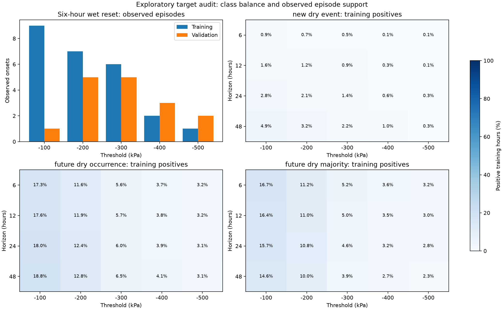

# Alternative target definitions

Team Iron Horse | November 4, 2026 | Exploratory audit

We audited 60 numerical target definitions without fitting another classifier. Changing the threshold increases observed training episodes, but leaves very few new test episodes. Including already-dry soil produces many positive hours, while current-state persistence already predicts most outcomes correctly.

We have not adopted a candidate. Our original protocol, baseline F1 of 0.379310, RF result, and not-evaluable hypothesis status remain unchanged.

## What we fixed before counting

Our [audit plan](target-audit-plan.md) specifies five thresholds (-100 through -500 kPa), four horizons (6, 12, 24, and 48 hours), and three outcome families. These thresholds are numerical comparisons. We do not claim that they are vineyard-specific irrigation thresholds or validated calibrations.

| Family | Eligibility and positive outcome |
| --- | --- |
| New dry event | Current hourly median above the threshold, followed by any accepted future raw reading at or below it. |
| Future dry occurrence | Any accepted future raw reading at or below the threshold, including forecasts when soil is already dry. |
| Future dry majority | At least half of expected future hourly medians are at or below the threshold, including currently dry locations. |

Majority labels remain uncertain if unobserved bins could change the answer. We never impute future observations. No covered window in this export was ambiguous under the majority rule.

We retain January-May training, June validation, and July-August testing. History still requires four valid hourly medians in six hours and 18 in 24 hours. Future coverage requires five-sixths of hourly bins, rounded up, and no observation gap above two hours, including endpoints.

We change the boundary purge with each horizon: `t + horizon < next boundary`. Scheduled counts therefore differ across horizons. Episode grouping retains the six-hour observed wet reset and gap censoring. The inventory counts raw threshold onsets for every family, not a separate majority-episode definition. Positive pre-onset opportunities must also satisfy the chosen outcome label.

## Threshold changes move the shortage across seasons

This table uses the 24-hour new-event target. Episode counts describe observed onsets at the candidate threshold. They are not proof of independent events.

| Threshold, kPa | Positive training hours | Training episodes | Validation episodes | Test episodes | Positive test sensor-days |
| ---: | ---: | ---: | ---: | ---: | ---: |
| -100 | 205 | 9 | 1 | 1 | 2 |
| -200 | 167 | 7 | 5 | 1 | 2 |
| -300 | 117 | 6 | 5 | 1 | 2 |
| -400 | 49 | 2 | 3 | 1 | 2 |
| -500 | 24 | 1 | 2 | 9 | 15 |

At -100 kPa, training includes nine confirmed episodes across three locations. Validation has one episode at one location, and testing has one episode. At -200 and -300 kPa, validation has five episodes, but testing still has one.

The less-negative thresholds are reached earlier in the year. Later observations are mostly already dry under those definitions. Excluding currently dry inputs therefore removes much of the late-season data from advance-warning evaluation.

## Longer horizons add labels, not episode onsets

This table retains -500 kPa and the new-event target.

| Horizon | Positive training hours | Training episodes | Positive validation hours | Positive test sensor-days |
| --- | ---: | ---: | ---: | ---: |
| 6 h | 6 | 1 | 19 | 13 |
| 12 h | 12 | 1 | 31 | 14 |
| 24 h | 24 | 1 | 45 | 15 |
| 48 h | 27 | 1 | 69 | 17 |

The 48-hour horizon reaches only 17 positive test sensor-days. It does not meet the registered minimum of 20. Overlapping labels do not create additional observed episodes. Coverage and boundary exclusions also change with the horizon.

## Future-state targets have more positives and strong persistence

These rows use a 24-hour horizon. Percentages describe the fraction of eligible hourly examples that are positive. Persistence predicts the current dry/wet state at the candidate threshold.

| Family | Threshold, kPa | Positive training hours | Training positive % | Validation positive % | Test positive % | Test persistence F1 |
| --- | ---: | ---: | ---: | ---: | ---: | ---: |
| Occurrence | -100 | 1569 | 18.0 | 98.2 | 91.5 | 0.997303 |
| Majority | -100 | 1371 | 15.7 | 97.7 | 91.2 | 0.998199 |
| Occurrence | -200 | 1085 | 12.4 | 92.0 | 91.1 | 0.997290 |
| Majority | -200 | 940 | 10.8 | 90.3 | 90.8 | 0.998190 |
| Occurrence | -300 | 522 | 6.0 | 75.9 | 90.6 | 0.997161 |
| Majority | -300 | 405 | 4.6 | 72.2 | 90.3 | 0.998180 |
| Occurrence | -400 | 337 | 3.9 | 56.9 | 89.4 | 0.997124 |
| Majority | -400 | 280 | 3.2 | 54.7 | 89.1 | 0.998156 |
| Occurrence | -500 | 274 | 3.1 | 43.3 | 70.7 | 0.968437 |
| Majority | -500 | 240 | 2.8 | 41.9 | 67.6 | 0.985303 |

At -500 kPa, future occurrence gives 274 positive training hours, compared with 24 for new events. It does not add raw threshold episode onsets. Most added positives describe an existing dry spell continuing.

The majority target reduces sensitivity to isolated raw dips. It still includes persistent dry states and does not create more observed transitions.

Across all horizons, future-occurrence test persistence F1 ranges from 0.957417 to 0.999344. Future-majority persistence F1 ranges from 0.979037 to 0.999235. A requirement to exceed those persistence scores by 0.05 would be impossible.

The original primary comparator remains the drying-trend baseline. This audit does not silently replace it. If we adopt a future-state question, persistence becomes a necessary comparison and the success criterion needs a documented revision.

## Support screening across all 60 candidates

We applied the original numerical support rule as a descriptive screen: both classes in training and validation, and 20 positive and 20 negative test sensor-days.

| Family | Candidates meeting that screen |
| --- | ---: |
| new dry event | 0/20 |
| future dry occurrence | 14/20 |
| future dry majority | 17/20 |

Meeting this screen under a new label does not establish the original hypothesis. It does not prove adequate statistical power, many independent transitions, or useful improvement over persistence.

We did not select a candidate using test F1. Scores from different target definitions answer different questions and are not a common model leaderboard.

## Training support figure



The first panel shows training and validation episode onsets. The remaining panels show positive training fractions for every threshold and horizon. All heatmaps use the same scale.

## Interpretation

Our current dataset supports a working checkpoint, but these alternatives do not resolve the limited evidence for new-event classification. The largest observed training count in this grid is nine episodes. The corresponding late-season new-event support is especially small.

Future-state classification is a different possible project question. It has more positive examples, but persistent conditions make a simple baseline difficult to improve.

We recommend preserving the current checkpoint. A final project focused on new drying warnings needs more observed wet-to-dry cycles or explicitly limited exploratory claims. Forecasting the magnitude or change in matric potential is another possible question, but this audit did not evaluate that regression task.

## Reproduce the audit

We use the pinned environment and a complete local reproduction described in the [checkpoint guide](checkpoint-guide.md). The recorded aggregate metrics alone do not include the decoded observations needed here.

```sh
source .venv/bin/activate
python -W error -m iron_horse.targets --run runs/reproduction --output runs/target-audit
python -W error scripts/verify_target_audit.py --run runs/reproduction --audit runs/target-audit
python -W error -m unittest discover -s tests -p 'test_*.py'
```

`--run` selects the completed source run. `--output` selects a new directory. The audit refuses existing output directories and locations inside the source run or recorded results. The verifier writes a new receipt. Its optional `--receipt` argument permits a new receipt path for a later verification.

We score four fixed references: always-defer, always-positive, current-state persistence, and a trend reference. New-event trend predictions require a negative six-hour trend and a threshold projection at the horizon. Future occurrence also predicts positive when currently dry. Future majority uses projected potential at the window midpoint.

We fit no classifier and tune no cutoff. The existing RF cutoff remains 0.70 for the registered result.

## Evidence and checks

The complete project suite passes 57 tests with warnings treated as errors. New synthetic checks cover horizon-scaled coverage, endpoint inclusion, majority ambiguity, currently dry inputs, boundary purging, trend references, and threshold-specific episodes.

A separate verifier uses rolling counts, raw dry-count prefixes, gap-overlap intervals, and cumulative recovery markers. It independently matches all 180 partition count rows, all 720 baseline metric rows, and every threshold spell identity.

The original -500 kPa, 24-hour new-event candidate reproduces the 24/45/211 positive hours, 1,638 eligible test hours, and original baseline F1. After the shared-loader change, the earlier episode audit also reproduces its four CSV outputs byte for byte and its original summary values.

- [All 60 candidates](../results/target-audit-2026-11-04/candidates.csv)
- [Coverage and exclusions](../results/target-audit-2026-11-04/coverage.csv)
- [Every baseline score](../results/target-audit-2026-11-04/baselines.csv)
- [Threshold spell inventory](../results/target-audit-2026-11-04/threshold_spells.csv)
- [Audit provenance](../results/target-audit-2026-11-04/summary.json)
- [Independent verification receipt](../results/target-audit-2026-11-04/independent_verification.json)

All recorded observations and the original protocol remain unchanged. The source run stays read-only. Candidate counts are exploratory evidence for discussing a revised research question, not confirmation of improved irrigation decisions.
