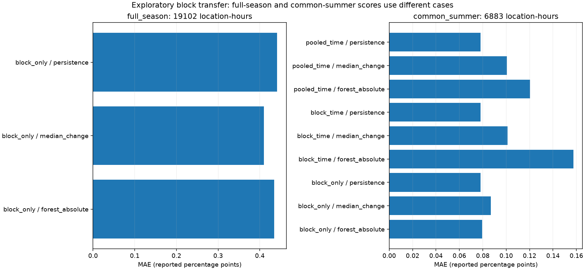
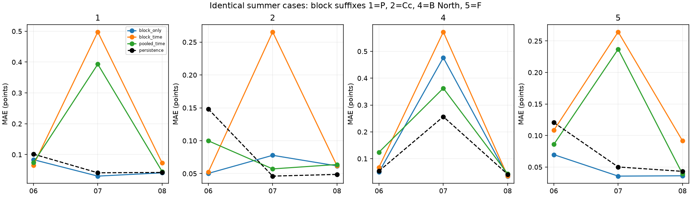

# Soil-water transfer across vineyard blocks and time

We tested both requested questions: transfer to another block within the
observed season, and forecasting later readings in a block excluded from
training. We also fitted a pooled time-only control. These splits answer
different questions and produce substantially different errors.

**Block-only transfer is more favorable than block-plus-time transfer on the
same summer cases. Neither beats persistence overall on those cases.** Across
the full observed season, the spatial forest slightly beats persistence, but
the training-median reference performs better than the forest.

The [fixed plan](block-transfer-plan.md) precedes fitting. We preserve the
original checkpoint and every earlier experiment. All available blocks and
months were already inspected during exploration. Holding out a block in
these fits does not create a newly untouched test or erase that prior inspection.

## Same summer cases: compare the split questions directly

All three designs are evaluated here on exactly **6,883 covered location-hours**,
across four blocks, 74 distinct dates, and 296 location-days. We matched both
timestamps and outcomes. Every metric uses reported water percentage points.

| Design | Persistence MAE | Training-median MAE | Forest MAE |
| --- | ---: | ---: | ---: |
| Block only | 0.07819 | 0.08681 | 0.07956 |
| Block plus time | 0.07819 | 0.10121 | 0.15742 |
| Pooled time control | 0.07819 | 0.10062 | 0.12046 |

`block_only` holds the entire target block out of fitting but uses the other
three blocks across January–August. This includes later-season examples when
evaluating an earlier held-block date. That is intentional retrospective spatial
transfer. It is not a prospective forecast test.

`block_time` holds out the target block and uses only earlier outcomes from
the other three blocks. Its forest has about twice the error of persistence.
`pooled_time` uses earlier outcomes from all four blocks, including the target
block's earlier labels. That control also loses to persistence.

The pooled control helps distinguish shared training from target-block exclusion.
Its error is lower than block-plus-time error, but it also has more training
rows and access to earlier target-block labels. The difference is not a pure
causal effect of location. We make no significance claim from these comparisons.



## Full observed season: question 2

The full-season spatial assessment holds out one block at a time. Each of
four forests fits on the other three blocks and predicts the held block.
No held-block target or preprocessing row enters its fit.

This assessment contains **19,102 location-hours**, 208 distinct dates, and
830 location-days. Eligible held-block outcomes span January–August and end
strictly before September 1 local time. There is no internal month purge in
this full-season scope. Its cases differ from the common summer subset above.

| Method | Pooled MAE | Equal block-month mean MAE |
| --- | ---: | ---: |
| Persistence | 0.44168 | 0.42538 |
| Training median | 0.40977 | 0.39456 |
| Absolute-error forest | 0.43406 | 0.42214 |

The forest improves pooled MAE over persistence by about **1.7%**. The median
reference improves it by about **7.2%**. Thus the small forest advantage over
persistence does not establish an advantage over a stronger constant reference.
Equal weighting of the 32 block-month MAEs preserves this ordering.

| Held block | Persistence MAE | Spatial forest MAE |
| --- | ---: | ---: |
| P | 0.48668 | 0.36040 |
| Cc | 0.52731 | 0.68859 |
| B North | 0.37020 | 0.38320 |
| F | 0.38352 | 0.30696 |

Full-season forest error is lower than persistence at P and F, but higher at
Cc and B North. The forest wins in 23 of 32 block-months, yet large errors
still matter to the aggregate. Counting wins cannot replace the error magnitudes.

## Month and block differences on common summer rows

| Month | Persistence | Block only | Block plus time | Pooled time |
| --- | ---: | ---: | ---: | ---: |
| 2026-06 | 0.10609 | 0.06336 | 0.07358 | 0.09593 |
| 2026-07 | 0.09848 | 0.15503 | 0.39998 | 0.26243 |
| 2026-08 | 0.04391 | 0.04340 | 0.06536 | 0.04790 |

Block-only transfer beats persistence in June and narrowly in August, but
loses in July. Both chronological designs beat persistence in June and lose
in July and August. These findings differ from the earlier separate-block
forests because the new models pool training across blocks.

| Block | Persistence | Block only | Block plus time | Pooled time |
| --- | ---: | ---: | ---: | ---: |
| P | 0.06063 | 0.05157 | 0.18394 | 0.14705 |
| Cc | 0.07971 | 0.06239 | 0.11351 | 0.07348 |
| B North | 0.10287 | 0.15745 | 0.18882 | 0.15412 |
| F | 0.06954 | 0.04662 | 0.14304 | 0.10681 |

On the three-month aggregate, the spatial forest beats persistence at P, Cc,
and F, while B North is worse. The B North errors outweigh those gains in
the pooled score. The block-plus-time forest loses to persistence at every
block on its three-month aggregate. The pooled time-only forest improves on
persistence only at Cc.

The spatial forest wins in nine of 12 summer block-months. Each chronological
design wins in four. Equal-group mean MAEs are 0.08728, 0.17965, and 0.13544
for the spatial, block-plus-time, and pooled-time forests, respectively.
Persistence is lower at 0.08283. The overall conclusion therefore does not
depend on weighting hours alone.



## What each model can observe

The outcomes remain individual reported single-probe water changes over the
next 24 hours. Routing is P: SE01-LS-2, Cc: SE01-LS-1, B North: SE01-LS-3,
and F: SE01-LS-4. Cc is mapped downslope, while the other three targets are
mapped upslope. We have not verified exact probe placement, depth, or calibration.
The transfer tests can therefore include placement and response differences.
We do not attribute any block's error to a confirmed physical cause.

Each evaluated block supplies its recent readings as inputs: current value,
lags, trailing summaries, slopes, and known calendar terms. Its labels never
enter the two transfer fits. This is a newly modeled location with recent
measurements, not a site with no sensor history. There is no block identifier,
block-specific predictor column, auxiliary sensor, or realized future weather
in the model. Reported percentages share units without establishing equivalent
physical calibration across probes.

Each model clones the same history pipeline and fits an absolute-error forest
with 200 trees, depth 6, minimum leaf 24, seed 514, and two worker threads.
Cloning clears fitted state. Imputation, scaling, and column selection fit only
the permitted pooled training rows. Training-median references use those same
rows, not held-block statistics. Targets remain observed and are never imputed.

## Splits, counts, and timing

We fitted **19 new forests**: four spatial, 12 block-plus-time, and three
pooled time-only controls. The four spatial models are reused for both their
full-season and common-summer scores. Scoring the second scope does not fit
another model.

| Design | Fits | Training rows per fit | Evaluated location-hours |
| --- | ---: | ---: | ---: |
| block_only | 4 | 14,311–14,368 | 19,102 |
| block_time | 12 | 9,009–12,140 | 6,883 |
| pooled_time | 3 | 12,027–16,143 | 6,883 |

Chronological fits use expanding earlier history. Every training outcome must
end strictly before its evaluated month. Every evaluated outcome must end
strictly before the next month. History observations can precede a fitting
window or month boundary, provided they are available by forecast issuance.
We use observation timestamps as the availability assumption and have not
audited packet-arrival latency.

For spatial fits, training can extend after a held-block evaluation timestamp
because its question concerns transfer within an already observed season.
It would be inappropriate to present that score as an estimate of a model
trained before the forecast date. Validation should match the intended spatial
or temporal prediction claim. See [Roberts et al.](https://doi.org/10.1111/ecog.02881).

The parent covered-eligibility rules remain unchanged. The common summer scope
applies the strict month-end purge to all three designs. The larger-change
assessment remains in the [earlier report](robust-forecast.md). We did not
choose new cutoffs, windows, features, or model settings after seeing these scores.

## Interpretation

Question 2 is a valid spatial-transfer experiment, and its score is more
favorable than question 3 on matched summer cases. It does not answer whether
the same model would have forecast those dates using only earlier observations.
Question 3 directly tests that harder claim and performs poorly overall here.

The full-season spatial forest's slight improvement over persistence is
insufficient to establish added value over the training median. We retain
both constant references. We do not choose a split because it produces a
better-looking score or treat the two scopes as interchangeable.

Only four blocks are available. They share a vineyard, weather, and observation
period. These folds do not establish geographic independence, transfer to other
vineyards, or a reliable irrigation recommendation. The result remains an
exploratory comparison with explicit differences among blocks and months.

## Reproduce and verify

Use the [pinned environment](../README.md#create-the-experiment-environment)
and a verified continuous parent run. From the repository root:

```sh
source .venv/bin/activate
python -W error -u -m iron_horse.transfer --parent runs/continuous-forecast --output runs/block-transfer
python -W error scripts/verify_transfer.py --parent runs/continuous-forecast --audit runs/block-transfer
python -W error -m unittest discover -s tests -p 'test_*.py'
```

`--parent` reads trusted cached observations and fixed pipeline parameters
from the earlier continuous experiment. Its loader verifies parent code,
plan, receipt implementation, examples, predictions, and control-model hashes.
`--output` creates a new directory outside the parent and recorded results.
It refuses an existing output. `--audit` selects the generated evidence for
independent checking. No earlier run is overwritten.

The actual parent is `runs/continuous-forecast-2026-11-04`. This run writes
`runs/block-transfer-2026-11-05`. Models and row-level predictions stay in
ignored runs. The [recorded evidence](../results/block-transfer-2026-11-05/)
contains all score tables, split counts, two figures, model hashes, and receipts.

Independent replay verifies all 19 models and split/preprocessing rules,
98,604 prediction rows, 204 block/month/scope scores, 12 pooled scores,
5,154 daily errors, and common evaluation identities. It verifies held-block
exclusion, chronological outcome purges, shared numeric columns, baseline
medians, and forest parameters. All 83 tests pass with warnings treated as
errors. We visually checked both figures. Prior protocols, source observations,
and results remain unchanged. We have not pushed or submitted this work.
