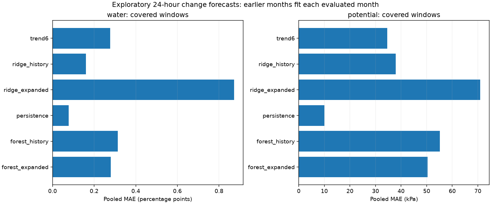
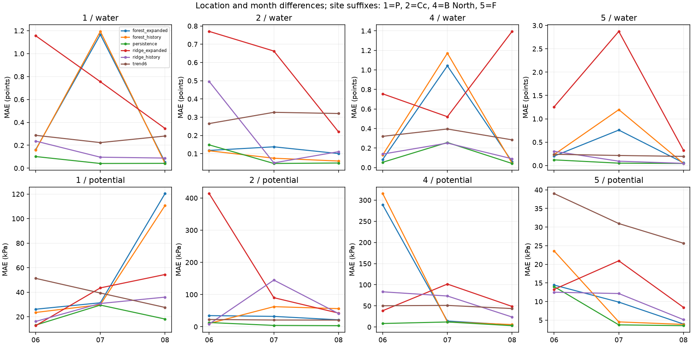
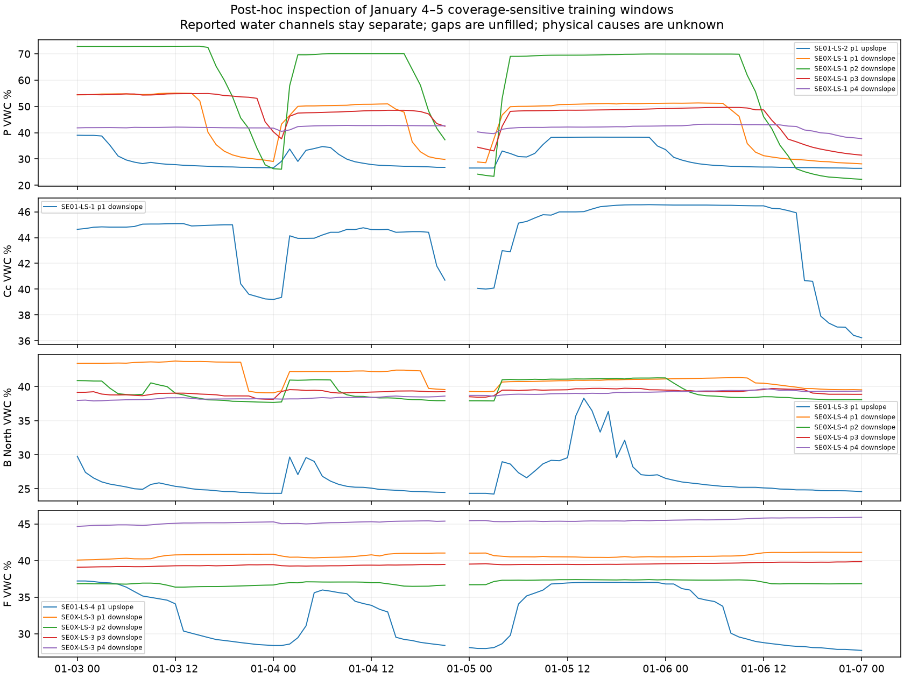

# Exploring cleaning choices and next-day forecasts

We compare forecasts of reported soil-water change with forecasts of reported
matric-potential change. Soil water is our main candidate outcome. We use four
individual routed water probes and their corresponding matric locations.
The question is whether past readings and observed weather improve forecasts
over persistence and a six-hour trend. We do not infer irrigation need.

Our [fixed plan](continuous-forecast-plan.md) defines the outcomes, coverage,
chronological folds, predictors, and model settings before fitting. This is an
exploratory comparison following our [sensor diagnosis](sensor-comparison.md).
Earlier inspection already covered all available months. These month scores
do not constitute a new untouched test or amend the original preregistration.

## Results

**Persistence has the lowest pooled MAE for both outcomes under both coverage
choices.** The learned models also lose to persistence in each month when we
pool locations. Fixed richer models do not establish predictive improvement.

We fitted 192 models: two outcomes, four locations, three months, two coverage
choices, two predictor sets, and two algorithms. The baselines require no fit.
For soil water, covered windows provide 6,883 scored location-hours across
74 distinct dates and 296 location-days. Complete windows retain 6,758 hours,
125 fewer. Covered water has 74 scored dates at each location. Complete water
has 74 at P, 72 at Cc, 74 at B North, and 73 at F: 293 location-days.
These are correlated observations, not 296 independent replications.

| Soil-water method | Covered MAE, 6,883 hours | Complete MAE, 6,758 hours |
| --- | ---: | ---: |
| Persistence | **0.07819** | **0.07856** |
| Six-hour trend | 0.27774 | 0.27706 |
| Ridge, history | 0.16044 | 0.13819 |
| Ridge, expanded | 0.87190 | 0.80784 |
| Forest, history | 0.31336 | 0.10368 |
| Forest, expanded | 0.28036 | 0.12054 |

All errors in this table are reported percentage points. The median absolute
observed water change is 0.040 points in the covered evaluation. Its 90th and
99th percentiles are 0.160 and 0.620 points. Much of this evaluation period
changes slowly, so a zero-change forecast is difficult to beat. Low persistence
error does not establish that important wetting events are predictable.

| Matric-potential method | Covered MAE, 6,896 hours, kPa |
| --- | ---: |
| Persistence | **10.04141** |
| Six-hour trend | 34.60653 |
| Ridge, history | 37.93769 |
| Ridge, expanded | 70.92907 |
| Forest, history | 55.10532 |
| Forest, expanded | 50.30939 |

Complete potential windows retain 6,851 hours. Persistence MAE is 10.07696 kPa
there. The potential training rows are identical under both choices, so fitted
predictions on common evaluation hours agree. Their pooled scores change only
because 45 evaluation hours are removed.



The conclusion is also unchanged when we average the 12 location-month MAEs
equally. For covered water, persistence has equal-group MAE 0.08283 versus
0.37208 for the history forest. For complete water these are 0.08265 and
0.10822. The history forest beats persistence in only one of 12 covered
location-months and three of 12 complete location-months. Occasional local
improvements do not establish a reliable advantage.



## Why complete coverage changes the water forest

The common-row comparison separates changes in fitted models from changes in
the evaluation sample. On the same 6,758 water evaluation hours, the history
forest trained with covered windows has MAE **0.31804**. The forest trained
with complete windows has MAE **0.10368**. Persistence is **0.07856** on those
same hours. The improvement is therefore not just easier retained test hours.
It still does not outperform persistence.

After seeing this sensitivity, we inspected the removed training windows.
This is an explicitly post-hoc diagnosis, not an additional model search.
The complete rule removes the following water training examples in every fold:

| Location | Removed training hours | Dates containing those issue times | Range of their observed 24-hour changes, points |
| --- | ---: | --- | ---: |
| P | 44 | January 4, 5, and 20 | −11.710 to +11.470 |
| Cc | 2 | January 20 | −0.010 to +0.105 |
| B North | 45 | January 4, 5, and 20 | −13.320 to +13.440 |
| F | 45 | January 4, 5, and 20 | −9.150 to +8.810 |

At P, B North, and F, 42 removed examples per site fall on January 4–5.
They overlap in time. Removing these windows changes the representation of
large changes during fitting. It is not equivalent to proving that those
measurements are wrong. The same removed examples recur in each expanding fit,
so they must not be counted as three separate sets of physical events.



The January figure keeps the single-probe targets and other same-block probes
separate. Some channels change sharply while others change less. Station I
weather and matric observations are unavailable for this early interval.
Placement, calibration, acquisition behavior, and physical changes remain
unresolved. We have not turned these windows into a fault rule.

## What this supports

We can now run a continuous-outcome pipeline without requiring rare positive
episodes. The measured result is that fixed ridge and forest forecasts do not
improve on persistence in this screen. More predictors do not reliably help.
For complete water windows, adding channels worsens the forest's pooled MAE
from 0.10368 to 0.12054 points. We cannot interpret that as a causal test of
temperature because several channels are added together.

Our working direction remains **forecasting reported soil-water change**, with
persistence as the required reference. The present evidence does not justify
a predictive-superiority claim or choosing complete coverage as a general
quality rule. Complete coverage is a useful sensitivity analysis. We retain
the covered choice alongside it and preserve all source readings.

If we continue this question, the next scientific issue is performance during
material changes across different seasonal periods. Selecting another model
or filter because it wins on these months would need a new exploratory record.
We do not need a positive result to report the completed experiment honestly.

## What we clean and what we preserve

We preserve the established packet and value rules: conflicting keys, invalid
soil flags, known fault codes, unsupported decodes, and uncertain Cc units stay
excluded. Missing readings stay missing. We do not delete a value because it
jumps, reads zero, or correlates with temperature. We do not estimate truncated
Cc temperatures or apply an empirical temperature correction.

All accepted hourly medians at the four single-probe water targets fall between
9.69% and 46.55%. None is outside 0–100%. That basic range check does not
establish calibration or verify a particular reading's physical accuracy.

The new comparison changes observation-coverage eligibility, not recorded values.
The covered choice requires an observed current value, exact 6- and 24-hour
lags, enough recent observations, and no missing run longer than two hourly
bins. Its score needs an observed 24-hour endpoint, at least 20 of the next
24 bins observed, and no future missing run longer than two bins. The complete
choice requires all past 25 and future 24 bins. The plan gives every count.

Past eligibility describes when an input history is available. Future eligibility
describes when an outcome can be scored. Future coverage is not a predictor.
Only scored rows enter the saved evaluation predictions. Auxiliary channels can
still be missing under either choice. Their imputation is learned from training
data. Targets are never imputed.

## What each forecast means

At hour t we predict y(t+24h) − y(t), an elapsed 24-hour change between observed
right-closed hourly medians. Water errors use reported percentage points.
Potential errors use reported kPa. We do not pool those units into one score.
An MAE of one water percentage point means an average absolute change-forecast
error of one reported point. It does not mean one percent relative error.

Persistence predicts zero change. The recent-trend reference predicts
4 × [y(t) − y(t−6h)], without clipping. It differs from the registered
classifier's threshold-based drying-trend rule. These new errors cannot be
compared numerically with the original F1 scores.

We fit separate models for each outcome, location, coverage choice, and month.
June uses earlier training outcomes, July adds eligible June outcomes, and
August adds eligible July outcomes. A training outcome must end strictly before
the evaluated month starts. A scored outcome must end strictly before the next
month. Thus the last 24 issue hours of each month are purged. Available history
can cross the start of a month. No random train/test split is used.

Ridge uses alpha 10. Random forest uses 200 trees, depth 6, minimum leaf 24,
and seed 514. Each algorithm has a history version and an expanded version.
History includes current and lagged outcome values, trailing summaries, slopes,
and known calendar terms. Expanded models add separate same-block soil channels,
matric potential, strict internal temperature, and past station weather.
There is no realized future rain or temperature in the predictors.
We use observation timestamps as the availability cutoff. We have not audited
packet-arrival latency, so this is a retrospective forecast evaluation.

The training-only preprocessor removes unusable or constant fitting columns,
imputes other missing predictors with fitting medians, adds missing indicators,
and standardizes. We run fixed settings, with no search or winner selection.
Expanded-model differences do not isolate temperature from the other added
channels and cannot establish a temperature effect.

## Reproduce the exploration

Use the [pinned environment](../README.md#create-the-experiment-environment)
and a verified completed run. From the repository root:

```sh
source .venv/bin/activate
python -W error -u -m iron_horse.continuous --run runs/reproduction --output runs/continuous-forecast
python -W error scripts/verify_continuous.py --run runs/reproduction --audit runs/continuous-forecast
python -W error scripts/inspect_continuous_coverage.py --audit runs/continuous-forecast --output runs/continuous-coverage
python -W error -m unittest discover -s tests -p 'test_*.py'
```

`--run` reads a completed experiment's trusted cached observations and checks
their hashes. The command rebuilds the individual observed hourly channels
using the existing decoding and validity rules. `--output` creates a new
directory outside the source run and recorded results. It refuses an existing
directory. `--audit` selects the generated run for independent checking.
The inspection command creates separate post-hoc exclusion tables and the
January figure. It changes no fitted model, eligibility rule, or source value.

The actual run reads `runs/packaging-reproduction` and writes
`runs/continuous-forecast-2026-11-04`. Models, row-level examples, hourly data,
and predictions stay in ignored runs. Aggregate evidence is recorded separately.
The original protocol, checkpoint scores, episode audit, target audit, and sensor
comparison remain unchanged. We have not pushed or submitted this exploration.

## Verification and retained evidence

The [evidence directory](../results/continuous-forecast-2026-11-04/) contains all
300 location/month/stratum metric rows, 24 pooled rows, 48 coverage rows,
7,074 daily-error rows, and 144 common-row comparisons. It also includes the
post-hoc exclusion tables, three figures, model hashes, and verification receipts.
Row-level examples and predictions remain in ignored runs.

The separate verifier checked all 46,648 candidate examples and their eligibility,
6,792 sampled predictor values, and all 192 fitted preprocessors against their
permitted training rows. It replayed all 164,328 prediction rows and checked
every aggregate score table. The full suite passed 71 tests with warnings
treated as errors. All three figures were visually inspected.

The first artifact manifest accidentally included changing macOS metadata.
We restricted the manifest to declared scientific outputs and rebuilt it.
No model was refitted and no numerical artifact changed. The
[repair receipt](../provenance/continuous-forecast-2026-11-04/manifest-repair.json)
and [source patch](../provenance/continuous-forecast-2026-11-04/manifest-repair.patch)
preserve the original fitting-code hash and verify that the scientific source
syntax tree is unchanged after removing only the manifest-building difference.
