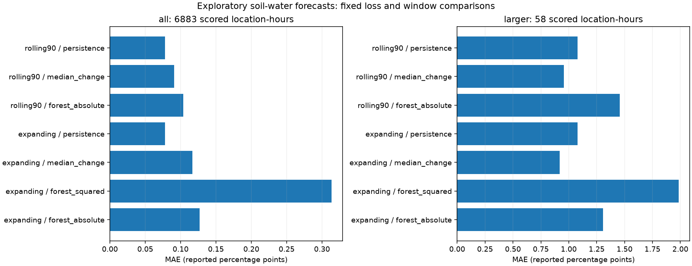

# Soil-water forecasts with median references and absolute-error forests

We completed the [fixed comparison](robust-forecast-plan.md) using the same
6,883 covered soil-water evaluation hours as the earlier continuous experiment.
Changing forest loss reduces pooled MAE substantially. Restricting training to
90 days reduces it further. **Neither forest nor training-median reference
beats persistence overall.** The absolute-error forests do beat persistence
in August, while losing in June and July.

These are exploratory results on months already examined during diagnosis.
They do not amend the original preregistration, establish sensor faults, or
provide evidence of irrigation need. We changed no cleaning rule or recorded
observation. The original checkpoint and all earlier experiments remain intact.

## Overall results

Each forecast predicts the reported single-probe water change over the next
24 hours. All errors below use reported percentage points. Every method is
scored on the same 6,883 hours, across four locations and 74 distinct dates.
There are 296 location-days. These overlapping examples are not independent events.

| Training history | Method | Pooled MAE |
| --- | --- | ---: |
| Any | Persistence, zero change | **0.07819** |
| Expanding | Training-median change | 0.11666 |
| Expanding | Existing squared-error forest | 0.31336 |
| Expanding | Absolute-error forest | 0.12713 |
| Previous 90 days | Training-median change | 0.09110 |
| Previous 90 days | Absolute-error forest | 0.10367 |

Changing only the forest criterion reduces its pooled error by **59.4%**
relative to the old squared-error forest. The expanding absolute-error forest
still has 62.6% more error than persistence. It also loses to the expanding
median reference. This meets the fixed trigger for the second comparison.

The 90-day forest improves a further **18.5%** relative to the expanding
absolute-error forest. Its error remains 32.6% above persistence. Equal weighting
of location-month MAEs gives the same overall ordering. The corresponding
forest MAEs are 0.37208, 0.13846, and 0.11299, versus 0.08283 for persistence.



## Month and location differences

The loss change does not help uniformly. It makes June worse than the old
forest and makes July much better. Both absolute-error forests beat persistence
in August. This supports further examination of seasonal differences, without
establishing a generally superior forecast.

| Evaluated month | Hours | Persistence | Expanding median | Squared-error forest | Expanding absolute-error forest | 90-day absolute-error forest |
| --- | ---: | ---: | ---: | ---: | ---: | ---: |
| June | 2,180 | 0.10609 | 0.10408 | 0.15931 | 0.21375 | 0.14907 |
| July | 1,840 | 0.09848 | 0.14707 | 0.90906 | 0.16438 | 0.15162 |
| August | 2,863 | 0.04391 | 0.10671 | 0.04782 | **0.03723** | **0.03828** |

Across the 12 location-months, the old forest beats persistence in one.
The expanding absolute-error forest wins in five, and the 90-day forest in six.
These counts do not weight error magnitude, so they do not replace pooled or
equal-group MAE. We retain every location-month score in the evidence tables.

The training-median reference always forecasts drying in this dataset.
Expanding medians range from −0.260 to −0.110 points. In the August fits,
90-day medians are −0.050 at P, −0.100 at Cc, −0.060 at B North, and −0.090
at F. A constant drying correction is not enough to improve overall MAE here.
Its smaller error with recent training is consistent with changing observed
drift, but this comparison does not identify a physical cause.

## What the larger-change subset contains

For each location and fold, we calculated the 90th percentile of absolute
training changes before scoring. We used linear quantile interpolation and
included an evaluation example only when its absolute change was strictly
greater than its cutoff. Cutoffs range from 0.4800 to 1.2840 reported points.
The 90-day fits retain these same expanding-history cutoffs.

Only **58 evaluated hours** exceed their cutoffs. All belong to B North in
July, with a cutoff of 0.7300 points:

| Local issue date | Hours | Range of observed next-day changes, points |
| --- | ---: | ---: |
| July 9 | 13 | −1.96 to −1.30 |
| July 10 | 24 | −1.30 to −0.80 |
| July 11 | 21 | −0.92 to −0.74 |

These issue dates follow the shared early-July source gap. Their physical
cause is unknown. They do not represent 58 independent drying events.
The other 11 location-month subsets are empty and remain explicit in the
tables. Training thresholds need not place 10% of later observations in the
larger-change subset, especially when distributions change.

| Method and training history | Larger-change MAE, same 58 hours |
| --- | ---: |
| Persistence | 1.08000 |
| Expanding median | **0.92000** |
| 90-day median | 0.95500 |
| Existing squared-error forest | 1.98506 |
| Expanding absolute-error forest | 1.30551 |
| 90-day absolute-error forest | 1.45700 |

Both median references improve on persistence in this small subset. They apply
a constant negative change to every forecast, rather than identifying these
hours in advance. Both forests still lose to persistence in the subset.
The subset depends on the future observed outcome and is an assessment tool,
not a forecast-time alert, eligibility rule, or cleaning filter.

## What changed in fitting

The first step retains the earlier covered examples, individual outcome probes,
history columns, purged June/July/August folds, and evaluated rows. We reuse
the old squared-error predictions and frozen controls. We fit one new forest
for each location-month, for 12 new fits.

Each new forest clones the old pipeline, changing only
`regressor__criterion` from `squared_error` to `absolute_error`. This criterion
controls both splitting and leaf predictions. The latter use medians for
absolute error. All other forest parameters stay identical, including 200
trees, depth 6, minimum leaf 24, seed 514, and two worker threads.
See the [official forest documentation](https://scikit-learn.org/stable/modules/generated/sklearn.ensemble.RandomForestRegressor.html).

The preprocessor is cloned and fitted on permitted training rows. It does
not retain fitted statistics from the control. The verifier confirms that
expanding preprocessing statistics match the old control exactly, because
their input rows and columns are unchanged. No evaluated targets enter fitting.

Before fitting, the plan specified a conditional second step: run it unless
the expanding absolute-error forest has lower pooled MAE than both constants.
The first step fails that check, so we fit another 12 forests using issue
times from the preceding 90 × 24 hours. The lower endpoint is included.
Each training outcome must still end strictly before the evaluated month.
Evaluated outcomes must end strictly before the following month.

The 90-day fitting counts are 1,770 rows per site for June, 1,619 for July,
and 1,335 for August. The scored rows remain identical. Gaps therefore reduce
available fitting observations without being filled. No additional window,
model, cutoff, or feature search follows this comparison.

## Interpretation

The criterion comparison supports sensitivity to the fitted loss as one reason
the original forest performed poorly. The window comparison also shows that
recent training can change results substantially. Neither result proves that
the large January observations were faults or should be removed.

Persistence remains the strongest overall reference in this experiment.
The August improvement is a useful descriptive finding, but selecting August
after examining the month scores would not establish generalization.
The larger-change assessment is too concentrated in one location-month to
support a broad claim about meaningful drying changes.

We retain soil-water forecasting as an exploratory question. The current
evidence supports reporting a diagnosed negative overall result, with explicit
seasonal differences. We have not adopted a winning model, changed the
registered checkpoint, or inferred irrigation actions from these forecasts.

## Reproduction and verification

Use the [pinned environment](../README.md#create-the-experiment-environment)
and a completed, independently verified continuous experiment. From the
repository root:

```sh
source .venv/bin/activate
python -W error -u -m iron_horse.robust --parent runs/continuous-forecast --output runs/robust-forecast
python -W error scripts/verify_robust.py --parent runs/continuous-forecast --audit runs/robust-forecast
python -W error -m unittest discover -s tests -p 'test_*.py'
```

`--parent` identifies the earlier continuous run. The loader checks its code
and plan hashes, verification implementation, examples, predictions, and all
12 required control models. Use only trusted local cached and model artifacts.
`--output` must be new, outside the parent and recorded results. `--audit`
selects the new run for independent replay. No prior directory is overwritten.

Our actual parent is `runs/continuous-forecast-2026-11-04`. The new run is
`runs/robust-forecast-2026-11-05`. Saved models and row-level predictions remain
in ignored runs. The [recorded evidence](../results/robust-forecast-2026-11-05/)
contains training statistics, the conditional decision, all aggregate scores,
the figure, model hashes, and verification.

Independent verification checks all 24 training-reference rows and forest
preprocessors, parameter identity apart from criterion, control prediction
identity, and all 48,181 prediction rows. It verifies 168 location/month/stratum
score rows, 14 pooled rows, 2,072 daily errors, empty-subset handling, and the
conditional trigger. The full suite passes 77 tests with warnings treated as
errors. We visually checked the generated figure. We have not pushed or
submitted this work.
