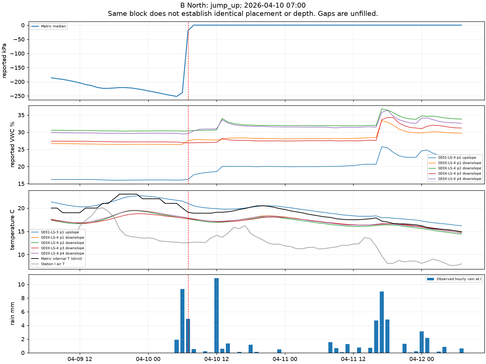
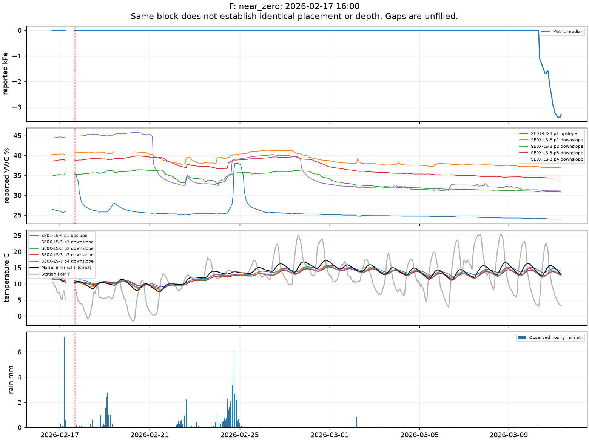
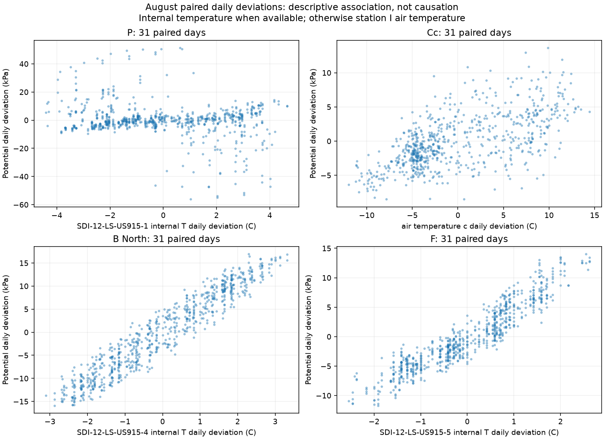
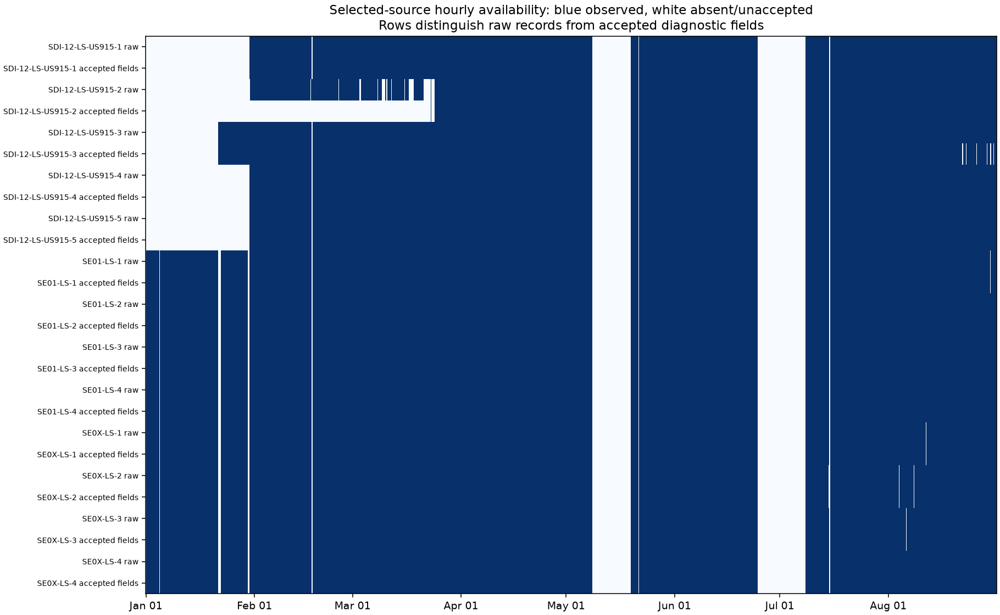

# Comparison with other vineyard sensors

We compared matric potential with individual soil-water and temperature probes
and the weather station before choosing new cleaning rules or fitting models.
The readings show several distinct patterns. Some large jumps have supporting
wetting evidence. Others have no comparable water-content response. Long
near-zero periods can hide changes visible in other soil probes. At two sites,
within-day potential fluctuations closely track local temperature.

These comparisons do not identify irrigation, prove sensor failure, or establish
an accurate measure of plant stress. We have sensor data only. We have no
irrigation schedules, maintenance records, or verified probe-placement survey.
We have adopted no new cleaning rule or target and fitted no model in this audit.

## Data and comparison method

We used the verified January–August source and the completed checkpoint run.
There are no September observations. The source hash and cached-input hashes
are recorded in the [summary](../results/sensor-comparison-2026-11-04/summary.json).
We preserved the existing fault, duplicate, checksum, soil-flag, and uncertain-unit
rules. Cc temperature uses complete Celsius fields only. We did not estimate
missing digits from truncated packets.

We retained each device and probe as a separate channel. Soil channels use
observed hourly medians. Weather fields use observed hourly means, except rain,
which sums valid distinct-time interval amounts. An hour labeled 12:00 contains
readings in (11:00, 12:00]. Missing values remain missing throughout.

Our routing metadata places the matric probes as follows:

| Block | Matric device suffix | Terrain | Soil comparison devices |
| --- | --- | --- | --- |
| P | `-1` | Upslope | SE01-LS-2 upslope and SE0X-LS-1 downslope, four probes |
| Cc | `-2` | Downslope | SE01-LS-1 downslope |
| B North | `-4` | Upslope | SE01-LS-3 upslope and SE0X-LS-4 downslope, four probes |
| F | `-5` | Upslope | SE01-LS-4 upslope and SE0X-LS-3 downslope, four probes |

Matric device names start with `SDI-12-LS-US915`. The weather station is device
`-3`, in block I. We also checked source availability for the Ca soil device.
Shared block and terrain do not establish identical depth, distance, soil, or
irrigation exposure. Water values are reported volumetric water-content percent.
Their differences below are percentage points. We have not verified site-specific
calibration.

We fixed the [comparison plan](sensor-comparison-plan.md) before counting:

- Large jump: an absolute change of at least 100 kPa between consecutive
  observed hourly medians. Same-direction flagged hours within six hours form
  one case, centered on the largest change.
- Near-zero run: at least 12 consecutive observed hours within 1 kPa of zero.
  Missing hours break the run.
- Common gap: at least six hours with no raw responses from any of the four
  matric devices, within their shared observed deployment range.

These are descriptive screens, not fault labels. We found **10 jump groups,
21 near-zero runs, and three common gaps**. All cases remain in the tables.

For jumps, we compared six preceding bins with six and 24 bins starting at the
selected hour. For near-zero runs, we compared their first and last six bins.
We report a median difference only if at least half of each window is observed.
Thus a six-hour window needs three observed hours. A 24-hour window needs 12.
These requirements describe this audit, not eligibility for the original forecast.
Rain around jumps covers all 30 bins from six before through 23 after the center.
It is not an instantaneous rain measurement at the moment of the jump.

## Large jumps have different supporting evidence

Times in this section use America/Los_Angeles. Values are rounded for reading.
The CSV tables retain full precision.

| Case center | One-hour potential change | Other sensor evidence | Interpretation limit |
| --- | --- | --- | --- |
| B North, April 10, 07:00 | +220.15 kPa, −239.00 to −18.85 | 31.824 mm station rain in 30/30 bins. All five block water channels rise. Four rise by at least one point | Consistent with wetting. Does not identify irrigation or establish its cause |
| P, July 14, 12:00 | +484.00 kPa, −513.90 to −29.90 | Downslope probe 4 rises 4.225 points. Same-terrain upslope probe changes only +0.005. Rain zero in 21/30 available bins | Spatially uneven response. Missing rain hours and placement differences prevent a firm cause |
| Cc, March 28, 14:00 | +956.05 kPa, −1687.25 to −731.20 | Same-terrain water changes −0.175 points. 0.085 mm rain in 30/30 bins | No matching water increase. Probe behavior and physical cause remain unresolved |
| B North, May 28, 08:00 | +356.05 kPa, −764.75 to −408.70 | 10.591 mm rain in 30/30 bins. Four of five water channels rise, all by less than one point | A large potential response need not imply an equally large water-content response |

At B North on April 10, the upslope water median rises from 16.090% before the
jump to 19.985% in the following 24 bins: +3.895 points. The four downslope
changes are +1.615, +1.555, +0.328, and +1.840 points. Each comparison has all
six preceding and 24 following bins. The upslope soil and matric temperatures
fall by 1.9 and 1.8 °C. Together, these independent channels support a wetting
interpretation. They do not prove a particular water source.



At P on July 14, the 24-bin comparison has only 15 observed following hours
because a common gap starts the next day. The strong water increase is in a
downslope probe. The matric probe is mapped upslope. This could reflect local
wetting or different placement and response, among other causes. A zero station
rain sum with nine missing bins cannot establish dry weather at P.

At Cc, the March 28 rise follows several large downward jumps. The largest
downward case is −713.65 kPa on March 27 at noon. The water median changes
−0.230 points over its 24-bin comparison. Strict internal temperature lacks
enough preceding observations for either case. We cannot use estimated packet
temperatures to resolve this uncertainty. We also cannot identify a fault solely
because a different probe responds less.

The screens find no ≥100 kPa one-hour jump at F. No other matric device has a
≥100 kPa change within one hour of any selected jump center. This describes
the chosen screen. It does not exclude smaller shared responses or time lags.

## Near-zero potential does not mean constant water content

Near-zero run counts are P: nine, Cc: four, B North: four, and F: four. The
longest runs contain 466, 226, 421, and 496 observed hours, respectively.
The 496-hour F run lasts about 20.7 days, from February 17 at 16:00 through
March 10 at 08:00 local bin labels.

During that F run, the same-terrain upslope water median falls from 34.338%
in the first six bins to 24.145% in the last six: **−10.193 percentage points**.
The four downslope changes are −3.505, −4.315, −4.350, and −13.515 points.
All comparison windows are complete. Station rain totals 64.277 mm over all
496 observed bins. The water series is not monotonically declining throughout.
The endpoint changes nevertheless show that near-zero potential does not
resolve all of the variation visible in water content.



The longest P and B North runs also have lower water medians at the end in all
five channels. All three runs start in the same hourly bin after a missing
preceding potential hour. Their starts are not confirmed wetting onsets.
Differences in sensitivity near saturation, nonlinear water-retention behavior,
placement, and instrument behavior remain possible explanations. We cannot
select one from these observations alone, or declare every zero invalid.

## Potential and local temperature share strong daily patterns

We paired observed hourly potential with each temperature channel, subtracted
each local day's paired mean, and calculated monthly zero-lag correlations.
Each included day needs at least 18 paired hours. A reported correlation needs
at least three days and variation in both channels. Removing daily means reduces
seasonal drift but does not remove daily cycles, time dependence, or common causes.

August was the planned late-season figure. All correlations below include
31 paired days. Pair counts differ by temperature channel.

| Block | Internal temperature r (paired hours) | Same-terrain soil temperature r (paired hours) | Station I air temperature r (paired hours) |
| --- | --- | --- | --- |
| P | −0.224 (744) | −0.158 (744) | −0.201 (718) |
| Cc | Unavailable (0) | +0.648 (740) | +0.627 (718) |
| B North | +0.958 (743) | +0.932 (743) | −0.265 (717) |
| F | +0.935 (744) | +0.758 (743) | −0.127 (718) |

B North also has correlations of +0.965 to +0.990 with the four independent
downslope soil-temperature channels. F has +0.797 to +0.950. Thus the pattern
is also present in separate soil devices, beyond temperature decoded from the
matric packet. Its cause could include physical daily cycles or temperature
sensitivity. This audit cannot distinguish them.



Cc has 744 raw-response and accepted-potential hours in August, but zero strict
internal-temperature hours. We show station air temperature in its scatter
panel and label that substitution. We have not reconstructed its internal
temperature. Weak zero-lag air correlations at other sites do not rule out
weather effects: soil temperature can differ in timing and amplitude from air.
The repeated hourly pairs are not independent experiments. We make no causal
or significance claim and have applied no temperature correction.

## Shared missing data differs from an uninterpretable channel

All 13 selected devices lack source rows during these common gaps. The count
was checked directly in the cleaned source cache, not inferred from a plot.

| First and last missing hourly bin labels, local time | Missing bins | Soil or weather raw bins present |
| --- | --- | --- |
| May 8, 11:00–May 19, 11:00 | 265 | 0 |
| June 24, 17:00–July 8, 10:00 | 330 | 0 |
| July 15, 02:00–10:00 | 9 | 0 |

These are complete missing right-closed bins, not exact failure timestamps.
For example, the first interval covers (May 8 10:00, May 19 11:00]. Their
shared absence points to a dataset-wide interruption for these selected sources.
It cannot distinguish radio, gateway, collection, export, or other causes.
Missing bins are not observed dry or wet states.

Cc has a separate interpretability problem: February has 666 raw-response hours
but no accepted potential hours under the existing uncertain-unit policy.
March has 584 raw hours, 184 accepted-potential hours, and 90 strict-temperature
hours. These are not equivalent to complete source outages.



## Instrument context and implications for the next question

The [METER TEROS 22 integrator guide, page 2](https://library.metergroup.com/Integrator%20Guide/18553%20TEROS%2022%20Integrator%20Guide.pdf)
describes a nominal −5 to −100,000 kPa range, possible 0 kPa readings on wetting,
and specified accuracy only from −5 to −100 kPa. It notes poorer calibration
beyond −100 kPa. Our export catalog identifies SDI-12 interface nodes but does
not establish the underlying matric-probe model. This guide is conditional
instrument context, not proof of the installed hardware or a basis for deleting
readings outside that accuracy interval.

The comparisons support keeping wetting evidence, temperature association,
near-zero behavior, missing source data, and decoding uncertainty distinct.
They do not support a single jump cutoff, removal of all zeros, or an empirical
temperature correction as a chosen cleaning policy.

Before a revised forecasting experiment, we need to specify what the observed
channel can support as an outcome. Forecasting its recorded value would require
explicit treatment of daily temperature patterns and wet-end plateaus. A claim
about irrigation need would require evidence we do not currently have. We have
not selected between revised questions or used these comparisons to tune a model.
The original checkpoint and its negative result remain part of the project record.
All months, including the old test period, have now informed this exploratory
diagnosis. They cannot become a newly untouched test merely by changing labels.

## Evidence and reproduction

The [evidence directory](../results/sensor-comparison-2026-11-04/) contains every
case, per-channel comparison and coverage count, monthly correlation, common
gap, figure, and the independent verification receipt. The five planned case
plots show the largest upward jump at each location with one, the largest
downward jump overall, and the longest near-zero run. After inspecting the
first response table, we added B North April 10 as an explicit descriptive
contrast: it has the most water channels rising by at least one reported point.
This extension is recorded in `summary.json`. We did not change the original plan.

Additional planned plots:

- [P July 14](../results/sensor-comparison-2026-11-04/SDI-12-LS-US915-1_jump_up_001.png)
- [Cc March 28](../results/sensor-comparison-2026-11-04/SDI-12-LS-US915-2_jump_up_002.png)
- [Cc March 27](../results/sensor-comparison-2026-11-04/SDI-12-LS-US915-2_jump_down_004.png)
- [B North May 28](../results/sensor-comparison-2026-11-04/SDI-12-LS-US915-4_jump_up_003.png)

From the repository root, use the [pinned environment](../README.md#create-the-experiment-environment)
and a completed local run. The following commands use `runs/reproduction` as
that run and create a new audit directory:

```sh
source .venv/bin/activate
python -W error -m iron_horse.sensor_compare --run runs/reproduction --output runs/sensor-comparison
python -W error scripts/verify_sensor_comparison.py --run runs/reproduction --audit runs/sensor-comparison
python -W error -m unittest discover -s tests -p 'test_*.py'
```

`--run` reads trusted cached observations from a completed experiment. It checks
their hashes before analysis. `--output` must be new and outside the source run
and recorded `results/` directory. `--audit` tells the separate checker which
generated evidence to verify. These commands do not fit models. Row-level
diagnostic Parquet files stay under ignored `runs/`. Only aggregate tables and
figures are included in the recorded evidence.

Our actual run used `runs/packaging-reproduction` and wrote
`runs/sensor-comparison-2026-11-04-reviewed`. The checker matched all 31 case identities and
boundaries, 364 response rows, 31 case summaries, and 192 monthly associations.
It also matched the frozen potential series, checked all three gaps directly
in source data, and checked 120 individual soil-hour medians and 30 weather
hour-field aggregates. These source checks are samples, not full decoder replay.
The full group suite passed 63 tests with warnings treated as errors.
